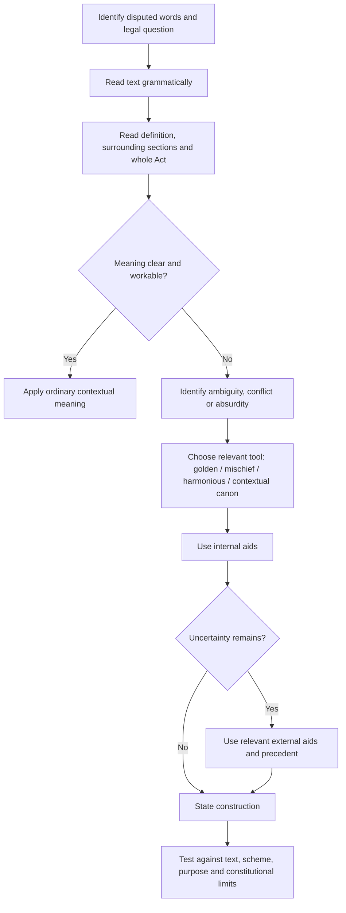
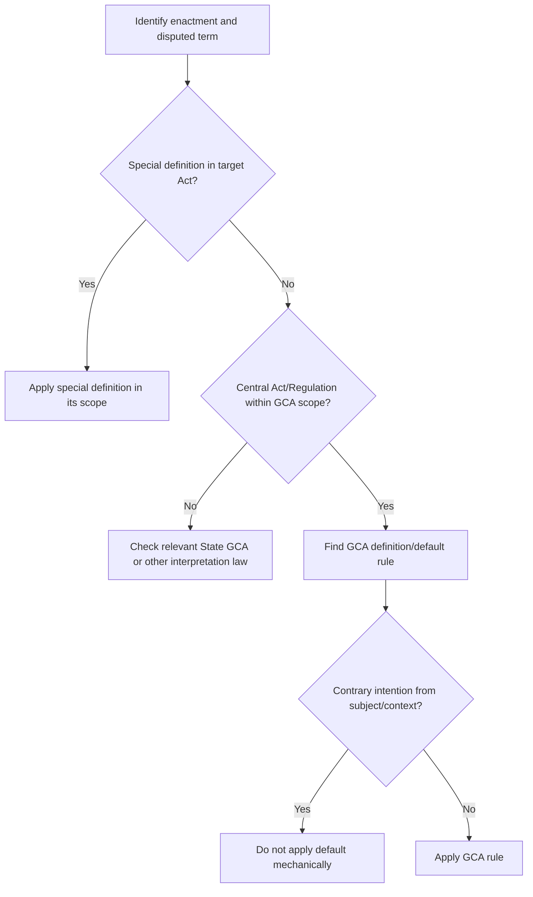

# Interpretation of Statutes — Flowcharts

## Choosing an interpretive rule



## General Clauses Act question



## Commencement, amendment and repeal

```mermaid
flowchart TD
 A[Identify enactment/amendment] --> B[Check commencement clause/notification]
 B --> C[Fix operative date]
 C --> D[Locate relevant conduct or transaction in time]
 D --> E{New rule changes substantive rights, liability or penalty?}
 E -->|Yes| F[Presumption against retrospectivity; inspect clear language/savings]
 E -->|No| G[Assess procedural/declaratory character and statutory intent]
 F --> H[Check GCA ss.5-6, s.24, express savings, Art.20(1)]
 G --> H
 H --> I[State effect on accrued rights and pending proceedings]
```
